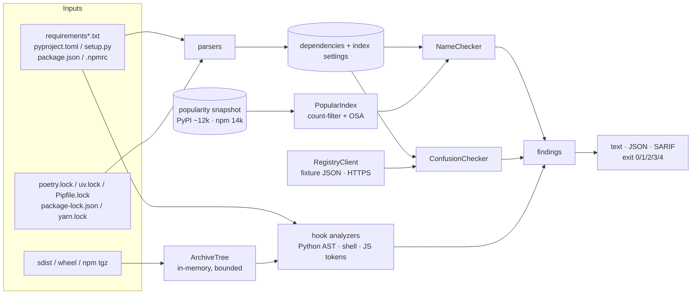

# squatwatch

**Find typosquats, dependency-confusion exposure and risky install hooks in npm
and PyPI dependencies — offline, explainable, CI-ready.**

```
$ squatwatch check -e pypi reqeusts jeIlyfish python3-dateutil requests
HIGH     SW102  <command line> score=0.90
         possible typosquat of jellyfish
         'jeIlyfish' resembles popular pypi package 'jellyfish' (popularity rank 1245): homoglyph: renders like 'jellyfish' ('I' for 'l')
HIGH     SW101  <command line> score=0.81
         possible typosquat of python-dateutil
         'python3-dateutil' resembles popular pypi package 'python-dateutil' (popularity rank 14): insertion: inserts '3' at 6 of 'python-dateutil'; combo: uses 'python3' instead of 'python' in 'python-dateutil'
HIGH     SW101  <command line> score=0.84
         possible typosquat of requests
         'reqeusts' resembles popular pypi package 'requests' (popularity rank 7): transposition: swaps 'ue' to 'eu' at 3 of 'requests'
```

## What and why

Attackers publish packages whose names are one slip away from popular ones
(`crossenv` for `cross-env`, `jeIlyfish` for `jellyfish`, 566 variants of
`requests`/`colorama`/`tensorflow`… in a single 2024 campaign), register an
organisation's *internal* package names on the public registry with a huge
version number (dependency confusion), and run their payload from install hooks
before anyone imports anything. squatwatch checks a repository for all three:

1. **Typosquat name signals** against a bundled snapshot of about 12,000 of the most
   downloaded PyPI projects and the 14,000 npm "high-impact" packages:
   restricted Damerau-Levenshtein edits, keyboard adjacency, homoglyphs
   (`I`/`l`, `0`/`o`, Cyrillic), separator and word-order tricks, npm scope tricks
   (`@typess/node`, `types-node`) and combo terms (`twilio-npm`, `jquery.js`).
   Every finding says *which* technique and *which* popular package.
2. **Dependency confusion**: names you declare internal are looked up through a
   pluggable registry client (an offline JSON fixture, or `--online` against
   pypi.org / registry.npmjs.org); lockfiles are checked for internal packages
   resolved from a public host; index settings that merge indexes
   (`--extra-index-url`, Poetry supplemental sources, unmapped npm scopes) are
   flagged.
3. **Static build-hook review** of `setup.py`, in-tree PEP 517 backends, `.pth`
   files in wheels and npm lifecycle scripts (plus the JS files they run) for
   network, process, dynamic-code, environment/credential access and
   decode-then-exec patterns — inside archives too, without extracting or
   executing anything.

Results come as text, JSON or SARIF 2.1.0 with CI-friendly exit codes.

**Who it is for:** teams that want a pre-merge check on dependency changes,
security engineers triaging a suspicious package archive, and anyone who wants
to understand how these attacks look in practice. It is a heuristic detector;
see [Limitations](#limitations).

## Architecture



Details, algorithms and complexity: [docs/ARCHITECTURE.md](docs/ARCHITECTURE.md).
Rules: [docs/RULES.md](docs/RULES.md). Threat model:
[docs/THREAT_MODEL.md](docs/THREAT_MODEL.md).

## Quickstart

Requires Python 3.12 and [uv](https://docs.astral.sh/uv/).

```bash
uv sync
uv run squatwatch scan .                         # manifests, lockfiles, hooks under .
uv run squatwatch check -e npm crossenv lodash   # ad-hoc names
uv run squatwatch review some-package-1.0.tar.gz # build hooks of an archive
uv run squatwatch scan . --format sarif -o squatwatch.sarif
```

Configure internal names and the CI gate in `squatwatch.toml` (or
`[tool.squatwatch]` in `pyproject.toml`):

```toml
fail-on = "high"                 # lowest severity that exits 1
min-score = 0.6                  # typosquat reporting threshold
allow = ["pypi:requests-mock"]   # known-good look-alikes
registry-fixture = "registry.json"  # offline registry answers (or pass --online)

[internal]
names = ["acme-billing"]
patterns = ["acme-*"]
npm-scopes = ["@acme"]
```

| Exit code | Meaning |
|---|---|
| 0 | no finding at or above `--fail-on` |
| 1 | at least one finding at or above `--fail-on` |
| 2 | usage error |
| 3 | input error (missing path, bad config, unparseable manifest); `--ignore-errors` turns it off; findings take precedence |
| 4 | internal error |

## Demo

`make demo` runs everything offline against `examples/` (a fictional "acme"
organisation with planted look-alikes, internal packages, a lockfile that
resolved an internal package from the public registry, and six inert fixture
archives). Excerpt from a real run:

```
$ squatwatch scan examples/webapp-py examples/webapp-js --config examples/squatwatch.toml
CRITICAL SW203  examples/webapp-js/package-lock.json:15
         internal package resolved from a public registry
         @acme/ui-kit is declared internal but the lockfile resolved it from registry.npmjs.org; the installed artifact may be an attacker's public package
CRITICAL SW203  examples/webapp-py/poetry.lock:23
         internal package resolved from a public registry
         acme-auth is declared internal but the lockfile resolved it from pypi.org; the installed artifact may be an attacker's public package
CRITICAL SW201  examples/webapp-py/requirements.txt:10
         internal package name exists on the public registry
         acme-billing is declared internal but a public package of that name exists (public latest 99.0.0 outranks internal 1.4.0); a resolver that consults the public index may install it
HIGH     SW104  examples/webapp-js/package.json:18 score=0.96
         possible typosquat of @types/node
         '@typess/node' resembles popular npm package '@types/node' (popularity rank 147): scope: scope '@typess' imitates '@types' for '@types/node'; repetition: inserts 's' at 5 of '@types/node'
HIGH     SW101  examples/webapp-js/package.json:12 score=0.78
         possible typosquat of lodash
         'lodahs' resembles popular npm package 'lodash' (popularity rank 101): transposition: swaps 'sh' to 'hs' at 4 of 'lodash'
HIGH     SW101  examples/webapp-py/requirements-dev.txt:3 score=0.84
         possible typosquat of pytest
         'pytset' resembles popular pypi package 'pytest' (popularity rank 24): transposition: swaps 'es' to 'se' at 3 of 'pytest'
HIGH     SW204  examples/webapp-py/requirements.txt:2
         package indexes are merged (dependency-confusion prone)
         index https://pypi.acme.example/simple is consulted alongside the default index (role 'extra'); pip-style resolvers take the highest version from any index, so a public package can shadow a private one. Use a single proxying index or uv's first-index strategy.
HIGH     SW102  examples/webapp-py/requirements.txt:7 score=0.90
         possible typosquat of jellyfish
         'jeIlyfish' resembles popular pypi package 'jellyfish' (popularity rank 1245): homoglyph: renders like 'jellyfish' ('I' for 'l')
...
MEDIUM   SW205  examples/webapp-js/package.json:13
         internal npm scope is not mapped to a private registry
         no .npmrc maps @acme:registry=..., so packages such as @acme/ui-kit resolve from the default registry
MEDIUM   SW103  examples/webapp-js/package.json:11 score=0.70
         possible typosquat of cross-env
         'crossenv' resembles popular npm package 'cross-env' (popularity rank 1931): separator: drops '-' at 5 of 'cross-env'
MEDIUM   SW101  examples/webapp-js/package.json:14 score=0.66
         possible typosquat of left-pad
         'left-padd' resembles popular npm package 'left-pad' (popularity rank 5550): repetition: inserts 'd' at 7 of 'left-pad' (declared in 2 places)
...
scanned 7 file(s), 32 dependency entries; findings: 3 critical, 7 high, 7 medium, 1 info; 10 at or above fail-on=high
[exit code 1]

$ squatwatch review examples/archives/*      (finding headers only)
CRITICAL SW309  examples/archives/hooked-sdist-0.1.0.tar.gz/setup.py:20
CRITICAL SW310  examples/archives/inert-npm-fixture-0.1.0.tgz/package.json
CRITICAL SW309  examples/archives/inert-npm-fixture-0.1.0.tgz/scripts/setup.js:6
CRITICAL SW305  examples/archives/intree-backend-0.1.0.tar.gz/_fixture_backend.py:6
HIGH     SW304  examples/archives/hooked-sdist-0.1.0.tar.gz/setup.py:20
HIGH     SW301  examples/archives/hooked-sdist-0.1.0.tar.gz/setup.py:23
HIGH     SW101  examples/archives/hooked-sdist-0.1.0.tar.gz/setup.py:31 score=0.84
HIGH     SW312  examples/archives/startup_pth-0.1.0-py3-none-any.whl/startup_pth.pth:1
HIGH     SW311  examples/archives/unsafe-paths-0.1.0.tar.gz
...
scanned 6 file(s), 10 dependency entries; findings: 4 critical, 9 high, 6 medium, 2 low; 13 at or above fail-on=high
```

Note `left-padd`: the manifest says `"left-pad": "npm:left-padd@^1.3.0"`, so the
check runs on the alias *target*, which is what actually gets installed.

## Evaluation

Command: `make eval` (writes [eval/RESULTS.md](eval/RESULTS.md); runtime ≈ 10 s).
Data provenance: [DATA.md](DATA.md).

- **Historical incidents** — 628 malicious typosquat names from 8 documented
  incidents (npm 2017 "hacktask", SK-CSIRT 2017, PyPI 2018/2019, Sonatype 2020,
  IconBurst 2022, the March 2024 PyPI campaign). None were used to choose the
  threshold, but **18 of them were visible during development**: they are
  examples in unit tests, demo fixtures, docstrings or the rule reference (e.g.
  `urlib3`, `jeIlyfish`, `python3-dateutil`, `crossenv`, `twilio-npm`,
  `tensoflw`), and some features were written with them in view. Those 18 are
  listed in [`data/eval/dev-exposed.txt`](data/eval/dev-exposed.txt) and
  **excluded from every result below**; 610 incident names remain held out. A
  test fails if an incident name is used in code, tests or fixtures without being
  listed.
- **Benign** — 6,338 real packages ranked just *below* the snapshot cutoff
  (widely used, never seen by the detector), split dev/test by hash.
- **Generated** — synthetic squats of 400 popular names per ecosystem across 11
  techniques, split dev/test by target. Synthetic and partly circular (same
  technique families as the detector): a regression check, not a real-world claim.

Threshold `min-score = 0.60` was chosen on the **dev** split by "highest F1 with
false-positive rate ≤ 3%". Held-out **test** results at that threshold:

| test subset | precision | recall | F1 | FPR |
|---|---|---|---|---|
| all (incidents + generated vs benign) | 97.5% | 84.1% | 0.903 | 2.6% |
| **historical incidents vs benign** | 78.3% | **48.5%** | 0.599 | 2.6% |
| generated variants vs benign | 97.3% | 90.7% | 0.939 | 2.6% |

| historical incident (test) | names | recall | recall when the imitated package is in the snapshot |
|---|---|---|---|
| all incidents (held out) | 610 | 48.5% | 61.4% (of 482) |
| **all except the 2024 campaign** | 45 | **22.2%** | 50.0% (of 20) |
| PyPI Oct 2018 (`diango`, `djago`) | 2 | 100% | 100% |
| npm 2017 hacktask | 30 | 13.3% | 33.3% |
| PyPI March 2024 campaign | 565 | 50.6% | 61.9% |
| *development-exposed names (not held out, for reference only)* | *18* | *83.3%* | *83.3% (of 18)* |

The older incidents are where the exposure mattered: with the 17 older
development-exposed names included, "all except the 2024 campaign" read 40.3%
(62 names) and PyPI Oct 2018 / Dec 2019 read 100% / 100%. Those figures partly
measured names the detector was developed against, so they are no longer quoted.
The 2024 campaign has one exposed name (`tensoflw`, which is missed), so the
headline incident recall barely moves (49.5% with exposed names, 48.5% without).
When a held-out incident name is flagged, the predicted target matches the
labelled one 93.6% of the time. Read these numbers with the caveats below: precision depends
on the (arbitrary) ratio of malicious to benign names in the set — the FPR is
the number that transfers — and roughly half of real squats are two edits away
or imitate packages outside the snapshot, which this design deliberately trades
for a low false-positive rate. Besides the development-exposed names above, one
more evaluation-process caveat is disclosed in [DECISIONS.md](DECISIONS.md): the first run's held-out results were seen before
the generator gained substitution/double-edit families (incident recall moved
49.0% → 49.5%, both measured on all 628 names including the exposed ones).

## Benchmarks

Command: `make bench` (`scripts/bench.py`), Python 3.12.13, Apple-silicon laptop:

| ecosystem | snapshot | index load | names/s (benign names, mostly no match) | p50 / p95 per name | candidate search vs brute force |
|---|---|---|---|---|---|
| PyPI | 11,999 | 112 ms | 3,013 | 0.29 / 0.48 ms | 0.36 vs 12.1 ms/query (34×) |
| npm | 14,000 | 179 ms | 2,946 | 0.33 / 1.10 ms | 0.34 vs 12.2 ms/query (35×) |

The speed-up comes from a lossless character-count filter
(`OSA ≥ L1(counts)/2`), vectorised with numpy, in front of a banded OSA; see
[docs/ARCHITECTURE.md](docs/ARCHITECTURE.md#candidate-generation-lossless-character-count-filter).

## Quality gate

`make check` = `ruff format --check` + `ruff check` (zero warnings) + `mypy --strict`
+ fixture-archive reproducibility + `pytest` with a branch-coverage gate (85%).
Current: **177 tests, 96.5% branch coverage** (`make check`, coverage table printed
at the end). Tests include Hypothesis property tests (banded OSA vs an
independent oracle, edit scripts reproduce the target, index filter equals brute
force), a golden JSON report for the demo scan, CLI exit-code tests and a fake
HTTP transport for the registry client. `.github/workflows/ci.yml` runs the same
gate plus the demo and a self-scan.

Size: `find src -name '*.py' | xargs wc -l` → 6,235 lines (including docstrings
and blank lines); `find tests -name '*.py' | xargs wc -l` → 2,186 lines.

## Project layout

```
src/squatwatch/   checker, parsers/, hooks/, text/ (distance, homoglyph, keyboard), registry, report, cli
src/squatwatch/data/   popularity snapshots (PyPI, npm)
tests/            unit, property, golden-report and CLI tests
examples/         demo organisation: manifests, lockfiles, inert fixture archives
eval/, data/eval/ evaluation harness inputs and RESULTS.md
docs/             ARCHITECTURE, RULES, THREAT_MODEL
scripts/          bench, demo, snapshot and fixture builders
```

## Design decisions (summary)

Full list with trade-offs: [DECISIONS.md](DECISIONS.md).

- **OSA, banded, plus a lossless count filter** instead of SymSpell/BK-tree —
  measured: the deletion index needed ~130 MB for PyPI alone.
- **Fixed, explainable weights** per technique; every finding names its technique
  and target. Only the threshold and severity bands were picked on dev data.
- **Trust npm scope ownership**: a name under a scope that already ships popular
  packages cannot be a third-party squat, so it is not reported.
- **Nothing is executed**: Python via `ast`, npm scripts via `shlex`, JavaScript
  via a tokenizer; archives are read in memory with hard size/member limits and
  link/traversal entries refused.
- **Offline by default**: registry lookups go through a `RegistryClient` protocol;
  tests use a fake transport, the demo a JSON fixture, `--online` the real APIs.

## Limitations

- **Recall on real incidents is about 50%.** Squats two edits away from short or
  mid-length names, squats of packages outside the top 12k/14k (e.g.
  `capmonstercloudclient`), and names with no popular target (`smb`, `tkinter`
  in 2017) are missed. Lowering `min-score` trades recall for false positives
  (see the sweep in eval/RESULTS.md).
- **False positives exist** (2.6% FPR on the benign tail): legitimate packages
  that really are near popular names — `findup`/`find-up`, `pymantic`/`pydantic`,
  old unscoped names of packages that moved into scopes. Use `allow` for known-good
  names.
- **Popularity is a proxy.** The npm list can be gamed by inflating downloads; a
  squat that made it into the snapshot is treated as legitimate. Snapshots age;
  refresh with `make snapshot`.
- **Hook review is static and shallow by design**: no data flow, Python
  reachability only through plain-name calls, JavaScript only at token level
  (aliasing such as `const r = require; r("child_process")` evades it), and code
  that runs on import rather than install is out of scope.
- **Formats not supported:** pnpm-lock.yaml, `Pipfile` (the lock is supported),
  `setup.cfg`, conda, and non-literal `install_requires`.
- **Evaluation labels** for the 2024 campaign and the 2017 npm list are inferred
  targets; generated variants share technique families with the detector; benign
  names are *assumed* benign.
- The `--online` registry client is unit-tested with a fake transport only; it
  has not been exercised against the live registries in CI.

## Roadmap

- pnpm and Bun lockfiles; `setup.cfg`; Gradle/Cargo ecosystems.
- Learned scoring (logistic regression over signal features) trained on a larger
  labelled corpus such as OSV `MAL-` advisories, with the same held-out protocol.
- Package-metadata signals for confusion and squats (first-publish date,
  maintainer count, README similarity) through the registry client.
- A proper JavaScript AST (e.g. via a pinned parser) for alias-resistant hook review.
- Diff mode: only report names introduced by a PR.

## License

MIT — see [LICENSE](LICENSE). Bundled data licences are listed in [DATA.md](DATA.md).
