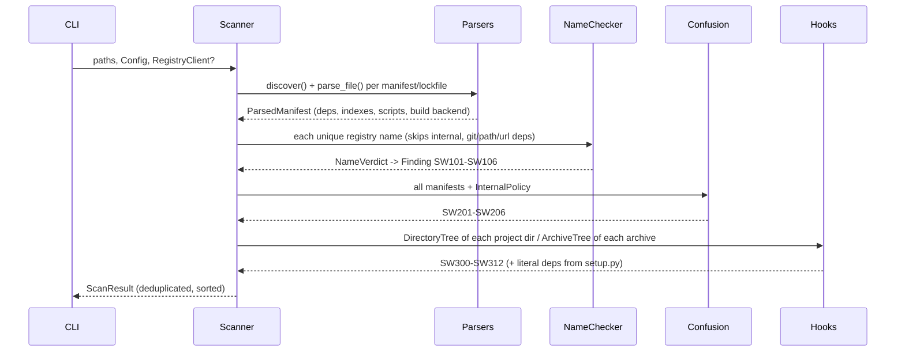

# Architecture

## Module map

```
src/squatwatch/
├── models.py            Ecosystem, Severity, Dependency, Finding, ScanResult
├── errors.py            SquatwatchError hierarchy
├── names.py             PEP 503 normalisation, npm scopes, tokens, validity
├── text/
│   ├── distance.py      banded OSA distance + edit-script traceback
│   ├── keyboard.py      QWERTY adjacency
│   └── homoglyph.py     confusable skeletons, script inspection
├── popular.py           PopularIndex: snapshot loader + similarity lookups
├── data/                bundled popular-pypi.txt / popular-npm.txt
├── checker.py           NameChecker: signals -> scored NameVerdict
├── parsers/             requirements, pyproject, setup.py, poetry/uv/Pipfile
│                        locks, package.json, package-lock, yarn.lock, .npmrc
├── versions.py          PEP 440 / SemVer ordering
├── registry.py          RegistryClient protocol, FixtureRegistry, HttpRegistryClient
├── confusion.py         InternalPolicy + ConfusionChecker (SW201-SW206)
├── hooks/
│   ├── tree.py          DirectoryTree / ArchiveTree (safe, in-memory)
│   ├── pyast.py         Python AST reviewer (imports, reachability, capabilities)
│   ├── jsscan.py        JavaScript tokenizer + pattern reviewer
│   ├── shell.py         npm lifecycle-script reviewer
│   ├── common.py        Capability/Hit, finalise() incl. SW309 composite
│   └── review.py        per-package orchestration (setup.py, PEP 517, .pth, npm)
├── scanner.py           discover -> parse -> name check -> confusion -> hooks
├── config.py            squatwatch.toml / [tool.squatwatch]
├── report.py, rules.py  text / JSON / SARIF 2.1.0, rule catalogue
├── evaluation.py        datasets, held-out split, metrics, markdown report
└── cli.py               scan / check / review / eval / snapshot
```

Dependencies only flow downwards: `text` and `names` know nothing about parsing;
parsers know nothing about detection; `scanner` is the only module that wires
detectors together; `cli` only parses arguments and renders.

## Data flow of `squatwatch scan`



## Name checking

### Restricted Damerau-Levenshtein (OSA), banded

`osa_distance(a, b, k)` fills only the diagonal band `|i − j| ≤ k` of the DP
table, keeps three rows (the transposition case needs row `i − 2`), and stops as
soon as a whole row exceeds `k`. Time is `O(k · min(m, n))` and space is `O(n)`.
A property test checks it against an independent textbook implementation for
random strings and bounds. `edit_script` computes the full table plus a
deterministic traceback (match/substitute, transpose, delete, insert) and runs
only for pairs that will be reported, to explain *which* typo it is.

### Candidate generation: lossless character-count filter

Comparing a query with every popular name costs about 12 ms/query in pure Python
(measured by `scripts/bench.py`). `PopularIndex.within` instead keeps an
`N × 42` `int16` matrix of per-character counts over `[a-z0-9-_.@/]` plus one
"other" bucket. For any OSA operation:

| operation | change of the count vector in L1 |
|---|---|
| insertion / deletion | 1 |
| substitution | ≤ 2 |
| transposition | 0 |

So `OSA(a, b) ≥ ‖c(a) − c(b)‖₁ / 2`, and `|len(a) − len(b)| ≤ OSA(a, b)`. One
vectorised numpy expression keeps the rows with `L1 ≤ 2k` and `|Δlen| ≤ k`.
Typically a few dozen candidates out of 12–14k survive, and only those are
verified with the banded OSA. The filter only discards pairs that are provably
farther than `k`, so results equal brute force (property-tested). The cost per
query is `O(N · Σ)` vectorised plus `O(c · k · n)` verification: about
0.3 ms/query, roughly 35× faster than brute force on this machine.

Alternatives considered (see DECISIONS.md): a SymSpell deletion index at `d ≤ 2`
needed about 130 MB and 2.7 s to build for PyPI alone. A BK-tree would need the
unrestricted DL metric (OSA violates the triangle inequality) and still visits
large parts of the tree at radius 2.

### Other lookups (all O(1) dict hits after O(N) build)

- `by_skeleton`: confusable skeleton → entries (homoglyphs).
- `by_collapsed`: name with separators, `@` and `/` removed → entries
  (separator tricks, scope flattening, glued affixes).
- `by_tokens` / `by_token_set`: token tuple / sorted tokens (combos, word order).
- `scope_rank` / `scopes`: npm scopes present in the snapshot.

### Signals and scoring

Each (query, popular target) pair collects signals. The score is:

```
score = max signal weight
      + 0.05 × (number of distinct technique families − 1)
      + rank adjustment   (+0.12 rank ≤ 100, +0.06 ≤ 1000, 0 ≤ 5000, −0.06 beyond)
      − short-name penalty (−0.14 if the shorter name has ≤ 4 chars, −0.08 if ≤ 5)
clamped to [0, 1]
```

| technique | weight | family |
|---|---|---|
| homoglyph | 0.90 (+0.05 if non-ASCII) | homoglyph |
| scope typo (`@typess/node`) | 0.85 | scope |
| repetition, transposition | 0.72 | typo |
| omission | 0.70 | typo |
| separator | 0.70 | layout |
| keyboard-adjacent substitution | 0.68 | typo |
| insertion | 0.64 | typo |
| substitution, combo, token-order, scope-flatten | 0.62 | typo / combo / layout / layout |
| two edits | 0.50 | typo |
| version digit (`pkg2`, `pkg` vs `pkg3`) | 0.50 | combo |
| re-scope (`@unknown/lodash`) | 0.50 | scope |

Rules that cut false positives:
- A query that is itself in the snapshot is never flagged.
- An npm query under a scope that owns popular packages is never flagged, because
  only the scope owner can publish there.
- Combo and token-order matches must stay within the same scope (or both be
  unscoped).
- Combo terms are generic filler words only, never domain words.

The highest-scoring target wins (ties go to the more popular one). A finding is
emitted when `score ≥ min_score` (0.60). How the threshold was chosen is
described in DECISIONS.md.

## Dependency confusion

`InternalPolicy` (names, fnmatch patterns, npm scopes) marks internal
dependencies. For each one:

1. **Lockfile proof (SW203).** The `resolved`/`source` URL host is a public
   registry. `poetry.lock` entries without `[package.source]` resolve to PyPI by
   definition.
2. **Exposure (SW201/SW202).** `RegistryClient.lookup` answers whether the name
   exists publicly and with which versions. A public latest version that
   outranks the internal pin (PEP 440 or SemVer precedence) is critical, because
   pip's `--extra-index-url` picks the highest version across indexes.
3. **Configuration (SW204–SW206).** Merging index roles (`extra`, Poetry
   `supplemental`/`secondary`, Pipfile secondary sources, uv only with
   `unsafe-best-match`), npm internal scopes without an `.npmrc` mapping, and
   unscoped internal npm names.

`HttpRegistryClient` uses an injected transport, a per-run cache keyed by match
key, bounded retries with exponential backoff on 429/5xx/connection errors, and
HTTPS only.

## Build-hook review

### Python (`hooks/pyast.py`)

1. **Import aliasing.** `import x as y`, `from a import b as c`, and
   `__import__("os")` / `importlib.import_module("os")` with literal arguments
   resolve calls to dotted names.
2. **Reachability.** Module-level statements (and class bodies) run when the
   build imports the file. Methods of classes whose base is a
   setuptools/distutils command (`install`, `develop`, `egg_info`, `build_py`...)
   run at install time. Calls by plain name (or `self.method`) from either are
   followed to a fixpoint over the module's functions. Everything else is
   "unreferenced" and reported one severity lower. Nested definitions inherit
   their parent's context.
3. **Capabilities.** Catalogues of network, process, dynamic-code, decoding,
   environment and credential-path APIs. `exec`/`eval` whose argument contains a
   decode call or an encoded blob is escalated to **critical** (SW305). The
   common `exec(open("version.py").read())` idiom is kept at LOW.
4. **Composite.** `finalise` emits SW309 when code that certainly runs both reads
   secrets (credential-like environment variables, the whole environment, or
   credential file paths) and opens network connections.

Cost: one `ast.parse` plus linear walks, `O(size of setup.py)`. The reachability
fixpoint is `O(F + E)` over functions and call edges.

### npm (`hooks/shell.py`, `hooks/jsscan.py`)

Lifecycle scripts (`preinstall`, `install`, `postinstall`, `preprepare`,
`prepare`, `postprepare`) are tokenised with `shlex` (punctuation-aware) into
pipelines and commands. A fetcher piped into an interpreter is SW310. Decoding
piped into an interpreter is critical SW305. `node <file>` hands the file to the
JavaScript reviewer. That reviewer tokenises comments, strings, template and
regex literals away from code (a regex is recognised by the previous token), then
matches short token windows: `require("child_process")`, network modules,
`process.env[.X]`, `eval`/`Function` (critical if the argument tokens decode
base64/hex), and credential paths in string literals.

### Archives (`hooks/tree.py`)

tar/tgz/zip/wheel members are indexed in memory without extraction. Limits are
20,000 members, 2 MB per file and 64 MB total. Absolute paths, `..`, links and
device entries are refused and reported (SW311). The single wrapper directory
(`name-1.0/`, `package/`) is stripped so reviewers can ask for `setup.py` or
`package.json` directly.

## Evaluation (`evaluation.py`)

- **Splits.** Salted SHA-256 assigns dev/test 50/50. Generated variants are split
  *by target*, benign names by name, and every historical incident is test-only.
- **Sweep.** Thresholds from 0.40 to 0.90 are tried on dev only. The selection
  rule is the highest F1 subject to FPR ≤ 3%.
- **Report.** Test metrics overall and per ecosystem/subset, recall by
  technique, recall by incident (overall and where the target is in the
  snapshot), whether the predicted target matches the labelled one, missed
  incident names, and the top benign false positives.

## Complexity summary

| Operation | Time | Space |
|---|---|---|
| Load snapshot + build indexes | O(N · L) | O(N · Σ) count matrix + dicts (≈ 1 MB matrix per ecosystem) |
| Check one name | O(N · Σ) vectorised + O(c · k · L) verification + O(scopes) for npm scope typos | O(N) temporary |
| Parse a manifest | O(size) | O(deps) |
| Review setup.py | O(AST nodes + call edges) | O(AST) |
| Review an archive | O(members) indexing + O(bytes read) ≤ budget | ≤ 64 MB |
